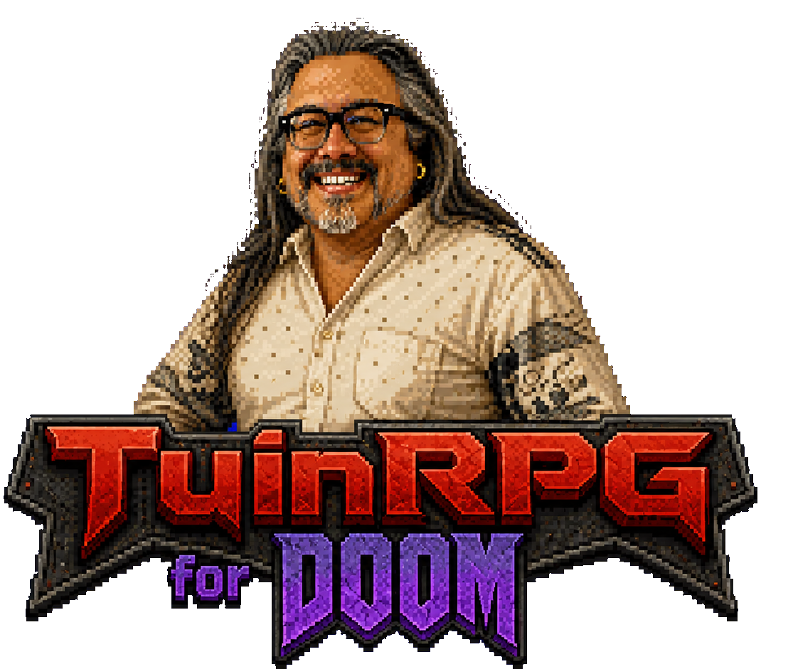

# TuinRPG for Doom

<p align="center"></p>

**v0.8.2 is the current main edition.** TuinRPG adds
loot-driven RPG progression to Doom. Build around
attributes, universal perks, permanent weapon specializations and weapon traits.

[Download TuinRPG.pk3](https://github.com/tuin-boop/TuinRPG/releases/latest/download/TuinRPG.pk3)
• [Quick Guide](QUICK_GUIDE.md) • [Older releases](https://github.com/tuin-boop/TuinRPG/releases)

## Installation

1. Use a recent GZDoom or UZDoom engine; this release was tested with **UZDoom 5.0.3**.
2. Supply your own Doom IWAD. Map packs and optional weapon mods are separate.
3. Load maps/content and your weapon mod, then **TuinRPG.pk3**.
4. Choose TuinRPG or Hell's Gambit under New Game.

```powershell
uzdoom.exe -iwad doom2.wad -file mymaps.wad myweaponmod.pk3 TuinRPG.pk3
```

No external weapon mod is required. Load only one TuinRPG package:
`TuinRPG_NoClasses.pk3` is the same edition under its earlier filename, not an addon.
Do not load the legacy class package alongside it.

## Features

- XP, character levels, five attributes and universal perks.
- Permanent weapon perks with benefits and tradeoffs, earned every five levels through level 30.
- Weapon variants with item levels, gear scores, damage, speed, critical, leech and other bonuses.
- Sixteen special traits, including Guard, Medic, Hunter, Survivor, Duelist, Momentum,
  Second Wind, Prospector and Quartermaster.
- Uncommon, Rare, Elite, Legendary, Mythic and Godly weapon rarities with distinct animated effects.
- Monster levels, rarity, affixes, signature attacks and an adaptive director that can promote threats.
- Finale bosses, boss chests, coins and John Romero's shop and conversations.
- Blue animated menus, character dashboard, arsenal and single-page quick weapon grid.
- Tilted current-weapon inspection and comparison panels for dropped weapons.
- Three-second hold-to-pick-up interaction, so a normal Use tap can still open doors.
- Improved boss bars with exact health, percentages, damage trails and resistance/trait labels.
- Animated notices for important combat, loot, key, progression and completion events.
- A face HUD, key display, flashlight, minimap and late-map Hunt for remaining enemies.
- Limited lives and revival in the normal campaign, plus end-level mission reports.
- Hell's Gambit: escalating single-life runs with a local high-score table.

## Controls

| Default key | Action |
| --- | --- |
| K | Character screen, attributes and perks |
| L | Arsenal and weapon traits |
| Q | Quick arsenal: select a weapon square and confirm/click to equip |
| I | Inspect your current weapon outside menus |
| N | Toggle minimap |
| F | Toggle flashlight |
| Hold E / Use for 3 seconds | Collect a nearby weapon drop |
| Tap E / Use | Normal interactions, doors and John |

Change bindings under **Customize Controls > Tuin RPG**. Existing bindings may override
defaults. The Escape menu's TuinRPG hub links to settings, help, modes and high scores.
The locator is a developer tool, not a normal gameplay feature.

## Character and loot

Spend stat points on Vitality, Strength, Luck, Agility or Endurance.
General perks and permanent weapon perks use separate points. Read each weapon
specialization's tradeoff before choosing; there are six weapon-perk points by level 30.

Rare/Elite items roll one special trait, Legendary/Mythic two and Godly three.
Higher rarity strengthens traits. **Always active** effects work from the selected
variant of a weapon you own even while holstered; only the strongest copy of each
passive applies. **Equipped** effects apply to the relevant weapon.

Look toward a drop to compare bonuses, then move close and hold Use for three seconds.
A replacement puts your previous variant on the floor. Drops have no automatic timed
despawn on the current map. Compare individual bonuses, not just gear score.

## Game modes

### TuinRPG

Play the loaded campaign with Ultra-Violence engine skill and adjustable RPG difficulty.
Changing RPG difficulty asks for confirmation and rebalances/rerolls living RPG monsters.
Advanced tuning is developer-password gated; normal players do not need it.

### Hell's Gambit

- Draws from the currently loaded MAP01–MAP29 pool, skipping missing maps.
- Not tied to Hellbound; requires Doom II-style map names.
- Starts with three distinct random Mythic-or-Godly weapons, full ammo and one life.
- Uses Hard RPG difficulty and Ultra-Violence engine skill.
- Randomizes supported monster groups while respecting size and boss restrictions.
- Each cleared map increases monster level, health/damage scaling and rarity pressure.
- Death finishes the run. Stage reports show score and the next stage's escalation.
- Your ten best finished runs are stored locally in the engine configuration.

## Enemies and exploration

Enemy rarities run from ordinary to Mythic, with a separate Boss tier.
Affixes can add armor, regeneration, speed and other threats. Read target traits
and resistance labels, and watch announcements when the director promotes enemies.

The minimap shows explored geometry and RPG markers. Late-map Hunt reveals survivors.
Boss rewards and John's shop provide end-of-map goals. Normal campaign play has
limited lives and revival; Hell's Gambit ends on death.

## Compatibility and saves

This edition does not activate bundled ProjectSIDE weapon replacements, class abilities
or the class quick-grenade system. External weapon mods retain their own weapons,
animations and sounds; TuinRPG adds progression on top.

Compatibility is best-effort, not a promise for every mod or total conversion.
Unusual weapon families, ammunition systems or scripted damage may need special support.
Single-player is the primary tested setup.

Incinerator and Calamity Blade support requires native ID24 support and appropriate
resources supplied by the player. Commercial weapon resources are not bundled.

Back up saves before upgrading. Start a fresh game when switching from the legacy class
edition; cross-edition saves are not guaranteed compatible. Keep your mod load order stable.

## Build and legacy versions

```powershell
./build.ps1
```

Builds the current `TuinRPG.pk3`. `build-noclasses.ps1` builds the same edition under
the old filename. Unused packaged assets are pruned while source assets are retained.

Older releases remain on GitHub. The previous local class build is preserved as
`TuinRPG_LegacyClasses.pk3`; `./build.ps1 -LegacyClasses` builds that source variant.
Legacy classes are not part of the current gameplay guide.

## Credits

See [THIRD_PARTY_NOTICES.md](THIRD_PARTY_NOTICES.md) and source-tree attribution files.
Optional weapon, voxel, monster and gore mods are separate projects. Doom belongs
to its respective rights holders.
